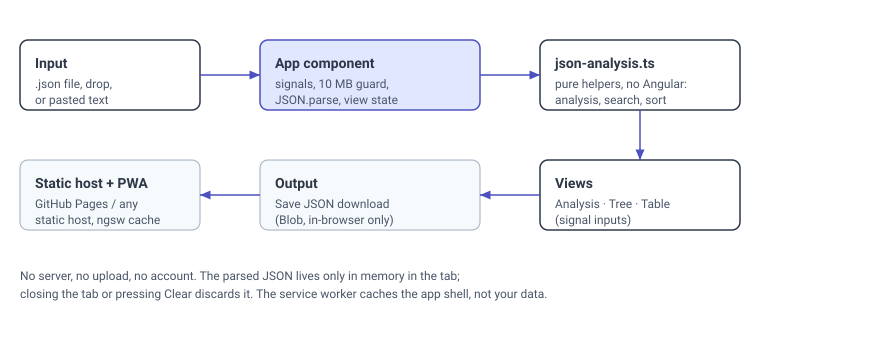

# JSON Insight

## Description

Inspect JSON files locally in your browser: analysis, tree view, and a sortable table view. A static progressive web app — your file never leaves your device. No uploads, no server, no account, no tracking.

Load a `.json` file by choosing it, dropping it on the page, or pasting JSON text, then switch between:

- **Analysis** — top-level type, item count (arrays), total keys, maximum depth, and a count of each data type found.
- **Tree View** — collapsible nested view. Deeper levels start collapsed; searching auto-expands matching branches.
- **Table View** — for arrays of objects. Headers are the union of all keys, sorting never mutates your data, and nulls always sort last.
- **Search** — filter keys and values across the tree and table views.
- **Save JSON** — download the loaded data pretty-printed.
- **Dark theme** — follows your system preference on first visit, with a
  Dark/Light toggle in the header. Your choice is saved locally (in
  `localStorage`, under `json-insight-theme`) and wins over later system
  changes; until you toggle, the app keeps following the system.

Files up to 10 MB are accepted; larger files are rejected before parsing so a huge file cannot freeze the tab. Everything is parsed and rendered on the client, in memory only — closing the tab or pressing Clear discards your data.



## Prerequisites

- Node.js 22.22.3 or newer on the 22 line, or 24.15+ / 26+ — this is the
  floor set by Angular CLI 22.2.5, not a preference (Node 20 fails before
  any test runs; see CHANGELOG v2.1.1). `.nvmrc` pins the 22 line, so
  `nvm use` in the repo root gets a working version; CI tests Node 22
  and 24.
- npm 10 or newer (ships with Node 22+; `packageManager` in `package.json` records the version used here).
- A modern browser. No backend, database, API key, or account is needed.
- Optional: Git, to clone the repository.

## Installation

```bash
git clone https://github.com/enonymous1/json-insight.git
cd json-insight
npm ci
```

`npm ci` installs the exact versions in `package-lock.json`. Do not use `npm install` for a clean checkout unless you intend to update the lockfile.

## Local Development

Start the dev server:

```bash
npm start
```

Open <http://localhost:4200/>, then load a JSON file or paste something like:

```json
[
  { "name": "Alice", "age": 30, "tags": ["a", "b"] },
  { "name": "Bob", "age": 25 }
]
```

The same example is checked in as [`examples/sample.json`](examples/sample.json) — load it to try all three views, including the Table View (an array of objects) and search (try `alice` or `paris` after loading your own nested file).

Other commands:

```bash
npm test        # Vitest, run once (ng test --watch=false)
npm run build   # production build in dist/json-insight/browser
npm run format  # Prettier over src/ and top-level JSON/Markdown
npm run format:check  # fail if any file is unformatted (what CI runs)
```

The editor setup in `.vscode/` (recommended extensions, tasks, launch config) is checked in; opening the folder in VS Code should offer the Angular and Prettier extensions.

### Project layout

```text
src/
  main.ts                    # bootstrapApplication with appConfig
  index.html                 # single manifest link, theme color
  styles.css                 # shared utilities + focus/dropzone styles
  app/
    app.ts / app.html        # file loading, drag-drop, paste, view switching
    app.config.ts            # one service-worker registration, error listeners
    json-analysis.ts         # pure helpers: analysis, search, sorting, formatting
    components/
      data-analyzer/         # analysis cards
      tree-view/             # recursive collapsible tree
      table-view/            # sortable, filterable table (non-mutating sort)
ngsw-config.json             # service-worker asset groups
public/
  manifest.webmanifest       # PWA manifest
  icons/                     # PWA icons
examples/
  sample.json                # example data for a first run and screenshots
docs/
  REVIEW.md                  # staff review: findings, fixes, and deferred work
  assets/
    architecture.svg         # architecture diagram shown above
```

Components use signal inputs and computed values with Angular's `@if` / `@for` / `@switch` control flow. There is no SSR, no Express server, no router, and no forms module: the app has no server-rendered content and no multi-page navigation, so a static build keeps the deploy simple and the service worker reliable.

### Privacy and limits

- No network request is made for your data. The only network activity is the browser fetching the app itself and the service worker caching it for offline use. The dark-theme choice is the only thing stored, and it is stored in your browser's `localStorage`, not on any server.
- The service worker caches the app shell, not your JSON. Your data is never written to disk by the app (except when you explicitly press Save JSON).
- The 10 MB limit is `MAX_JSON_BYTES` in `src/app/app.ts` and is checked before parsing, for files and for pasted text alike. A literal JSON `null` loads as "no data" (it is indistinguishable from the empty state); `0`, `false`, and `""` are real data and can be downloaded.
- Very large or deeply nested documents can still be slow to render: the tree and table render every node and row with no virtualization or row cap. That is a known limit, documented in `docs/REVIEW.md`, not a data-loss risk.

## Deployment

The production build is a static site. Serve `dist/json-insight/browser/` from any static host:

```bash
npm run build
# serve dist/json-insight/browser/
```

### GitHub Pages (included workflow)

`.github/workflows/pages.yml` builds with `--base-href /json-insight/` and deploys with GitHub Actions. One-time setup, after the first push:

1. Repository → Settings → Pages → Source: **GitHub Actions**.
2. Push to `main` (or run the workflow manually). The site deploys to <https://enonymous1.github.io/json-insight/>.

If you fork or rename the repository, update the `--base-href` in `pages.yml` to match the new repository name, or the deployed app will load from the wrong path and show a blank page. The same applies to `repository.url` in `package.json`.

### Stale service worker after a deploy

After the first visit, the installed service worker serves the cached app shell until the new version activates (the build uses `registerWhenStable:30000`). If a deploy looks stale, hard-refresh or close all tabs for the site and reopen it; do not clear site data to "fix" it unless the cached version is genuinely broken.

## History

v2.0.0 is a fresh, squashed export of the original Angular 19 project (`ss-angular-json-insight-pwa`, 2025). The original history is not included. v2.0.1 is the staff-review follow-up. See [CHANGELOG.md](CHANGELOG.md) for what changed in each.

## License

MIT. See [LICENSE](LICENSE).
